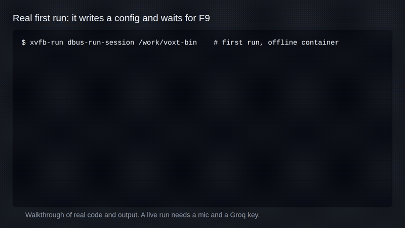

# voxt



Press a hotkey on Linux, speak, and the text lands on your clipboard.

```bash
sudo apt install -y git golang-go gcc pkg-config portaudio19-dev libayatana-appindicator3-dev libx11-dev && go install github.com/jayhemnani9910/voxt@latest
```

[](https://github.com/jayhemnani9910/voxt/actions/workflows/ci.yml)
[](LICENSE)

The GIF is a walkthrough, not a recording of live dictation. A live run needs a microphone and a Groq key.

## Setup

The install line puts the binary in `~/go/bin`. It needs Go 1.21 or newer.

voxt reads the hotkey directly from `/dev/input`, so your user has to be in the `input` group. Log out and back in after this:

```bash
sudo usermod -a -G input $USER
```

Run `~/go/bin/voxt` once. It writes `~/.config/voxt/config.json`. Get a key from [console.groq.com](https://console.groq.com) and put it in that file:

```json
{
  "groq_api_key": "your-key-here",
  "hotkey": "F9",
  "recordings_dir": "~/recordings"
}
```

The key is picked up on your next recording, so you don't have to restart. A changed hotkey needs a restart.

## Usage

1. Run `voxt`. A green icon shows up in the tray.
2. Press F9. You hear a beep and the icon turns red.
3. Speak.
4. Press F9 again. You hear a beep and the icon turns green.
5. When the transcription is back, the text is on your clipboard and a notification shows it for 3 seconds.

The tray menu has Settings, which opens the config file, and Quit.

Any key from F1 to F12 works as the hotkey.

## How it works

1. PortAudio records 16 kHz mono from your default mic, for up to 10 minutes.
2. The audio is saved as a WAV in `~/recordings/YYYY-MM-DD/`.
3. The WAV goes to Groq's `whisper-large-v3`, which detects the language.
4. The text goes to Groq's `llama-3.1-8b-instant`. English should come back unchanged. Hindi or Gujarati gets romanized, with an English translation after a `---` line.
5. If the Llama call fails, you get the Whisper text as it is.
6. The result goes into a SQLite history and onto the clipboard.

Example from the prompt in `transcribe/groq.go`:

```
kem cho bhai
---
How are you brother
```

The hotkey uses evdev, so it works on Wayland as well as X11. The clipboard uses `wl-copy` on Wayland if you have it installed, and the X11 clipboard otherwise.

## Privacy

Your audio and its transcript are sent to Groq. Nothing else leaves your machine.

Recordings and history stay on disk until you delete them. They are readable only by your user, and so is the config file. The app logs the length of a transcription, not its text.

## Files

| File | Location |
|------|----------|
| Config | `~/.config/voxt/config.json` |
| History | `~/.local/share/voxt/history.db` |
| Recordings | `~/recordings/YYYY-MM-DD/audio_HHMMSS.wav` |

`language_mode`, `auto_start`, `overlay_x` and `overlay_y` also appear in the config file, but the app doesn't use them.

## Other distros

Fedora:

```bash
sudo dnf install -y git golang gcc pkgconf-pkg-config portaudio-devel libayatana-appindicator-gtk3-devel libX11-devel && go install github.com/jayhemnani9910/voxt@latest
```

## Building from source

```bash
git clone https://github.com/jayhemnani9910/voxt.git
cd voxt
make check      # verify system libraries
make build      # build ./voxt
make test       # run the tests
make install    # copy to /usr/local/bin, asks for sudo
make autostart  # start on login, expects the /usr/local/bin copy
make help       # list every target
```

See [CONTRIBUTING.md](CONTRIBUTING.md) to work on it.

## Built on

PortAudio through [gordonklaus/portaudio](https://github.com/gordonklaus/portaudio), [getlantern/systray](https://github.com/getlantern/systray), [esiqveland/notify](https://github.com/esiqveland/notify) over DBus, [mattn/go-sqlite3](https://github.com/mattn/go-sqlite3) and [golang.design/x/clipboard](https://github.com/golang-design/clipboard).

## License

[MIT](LICENSE)
